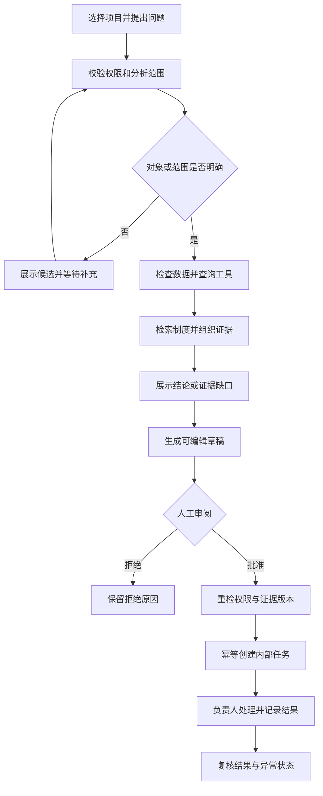

# 02 · 交互流程与页面规范

状态：目标交互规格。保留第三种 UI 的深蓝导航、任务看板与右侧详情；现有页面只是风格和布局草稿，下面的 Agent 交互尚未实现。

## 1. 信息架构与页面动作

| 页面 | 主要内容 | 主要操作与结果 |
|---|---|---|
| P01 Agent 工作台 | 当前项目、快照时间、问题输入、快捷核查、最近运行 | “分析当前快照”建立运行；输入问题发起核查；打开最近记录恢复查看 |
| P02 分析详情 | 输入/范围、步骤状态、结论卡、依据、缺口、建议 | 查看指标计算与原始行；打开引用段落；追问；生成草稿；反馈或取消运行 |
| P03 异常列表 | 类型、严重性、物资/科室、证据时间、处理状态 | 过滤、选择异常启动深入核查；标记无需处理须填写原因 |
| P04 处理任务 | 待确认草稿、已建待办、处理中、已完成；右侧详情 | 审阅/拒绝草稿、分派、开始、填写结果、完成、负责人关闭或重开 |
| P05 数据中心 | 导入历史、当前快照、质量报告、库存/批次/订单 | 上传、字段映射、预检、发布；筛选和授权导出；重新分析 |
| P06 知识库 | 文件版本、项目范围、有效期、审批与索引状态 | 上传与解析预览、设置范围、发布/停用、查看历史和引用位置 |
| P07 运行与设置 | 运行列表、失败类别、模型/提示词版本、用量 | 查看脱敏执行摘要、反馈；授权人员停用 AI、管理成员和发布配置 |

“已完成任务”和“风险已消失”分开显示。首页默认围绕 Agent 发起/回看分析，任务看板仍是业务执行入口；不将产品主体验退化为一个 CRUD 后台角落里的聊天浮窗。

## 2. 分析结果卡结构

每个结果包含：结论与类型；规则严重性；明确的分析范围和 as-of；关键指标及单位；可核验解释；引用；未知/冲突项；建议行动；按钮。

显示三个独立标记：数据状态（完整/缺失/旧快照）、证据状态（充分/不足/冲突）、生成方式（AI 分析/规则结果）。不显示模型自报的“95% 确信”等未经校准数字。

点库存指标打开数据侧栏：快照 ID、原始文件/行、批次、冻结/预留、公式输入与规则版本。点资料引用打开对应版本的章节或页码，突出被引段落；重新检查访问权限，不能用一个公开链接绕过鉴权。

“生成草稿”建立可审阅建议，不等于执行。草稿展示标题、措施清单、物资/异常关联、负责人候选、截止时间、证据版本、AI 建议与人工修改差异。

## 3. 主流程

图中的“重新核查失败”详见下面 J04，不允许沿成功路径继续建任务。

## 4. 分场景交互规范

### J01 · 数据导入与发布（F02/F03）

选择项目 → 选择数据类型/文件 → 展示字段映射 → 预检 → 错误报告 → 发布版本 → 选择是否发起分析。

预检页必须展示记录数、源时间、单位映射、重复记录和缺失分组。存在阻断错误时禁用发布，提供行号和修复说明。可接受的警告由授权用户确认并写入导入记录。发布是原子切换 current_snapshot_set，不能只发布一半文件。

更正已有记录走新的导入版本，不直接在网页把原始库存改成想要的值。取消导入不影响已发布版本。重复导入同一项目/类型/文件哈希返回原有记录并说明。

### J02 · 问题到分析（F04–F07）

输入“检验科未来两周哪些物资要关注” → 显示项目、时间窗口与数据版本 → 排队 → 查询/计算 → 检索 → 整理结果 → 展示完成范围。

已有明确上下文时直接运行；“这个产品”指向多个候选时展示可选物资，不猜一个。澄清状态释放运行资源，用户稍后补充可恢复；最多两轮仍不明确则要求用户从列表选定对象。

运行时用真实节点事件显示“已检查 24 项，其中 2 项数据不足”。未知总量时不伪造百分比。可以取消；取消后丢弃迟到模型输出，不再产生草稿或写操作。断开页面不会取消后台运行，重新进入按 run_id 读取状态。

### J03 · 证据查看与追问（F06/F07）

用户问“考虑在途以后还缺吗” → 绑定当前异常、项目与快照 → Agent 调用订单和模拟工具 → 展示新增证据与结论差异。历史分析不被原地覆盖。

用户改问另一医院时先检查权限并明确切换范围，不能从聊天文本提取任意 hospital_id 后直接查询。上传新快照后页面显示“有更新数据”，用户选择基于新版本重新分析。追问不能把未经验证的用户陈述当已发布数据写回库存。

### J04 · 草稿批准与冲突（F08）

生成草稿 → 人工修改行动/负责人/截止时间 → 保存新 revision → 点击“批准并建立内部待办” → 服务器重检 → 返回任务编号。

提交期间按钮禁用；网络超时显示“结果待确认”，以原 idempotency_key 查询批准结果，不让用户盲目再次创建。相同批准重试返回同一个 task_id。

如果草稿 revision 已变、关键库存/订单版本更新、依据已撤销或权限变化，则返回具体冲突：不创建任务；显示前后版本/数据差异；引导重新分析或审阅新草稿。用户曾批准旧草稿不能被解释为批准任意新内容。

拒绝需要简短原因，可重新生成一个关联的新草稿；拒绝不删除原分析。取消草稿和取消已建立任务是不同操作。

### J05 · 任务执行与反馈（F09/F12）

负责人打开待办 → 开始处理 → 记录核查事实和措施 → 填写结果完成 → 项目负责人复核，必要时重开或关闭异常。

完成只表明这项核查动作已执行，不自动修改库存、供应商交期或制度。若业务数据需更正，走数据导入/获准的后续系统接口。问题解决与否由新分析/人工复核证明。

“这条建议不准确”弹出反馈类别：数据不对、计算口径不对、引用不支持、建议不适用、其他，并允许备注。反馈关联分析版本和证据，进入人工评审；不会直接修改提示词或训练模型。

### J06 · 知识发布（F10）

上传 → 解析预览 → 填版本/范围/时间 → 检查冲突 → 有权限人员发布 → 索引完成后可用。

解析失败或 OCR 不支持时，明确要求文本文件；不生成空知识索引。相同制度的冲突版本暂不进入生效集合。停用立即影响新检索；历史分析保留原引用版本，但回看时标注“现已停用”。历史材料仅在授权的历史查看中可见。

### J07 · 模型/工具失败（F05/F11）

模型超时：保留已完成的规则结果，标记“AI 未完成”，允许手工核查或重试失败步骤。检索无依据：显示“未找到适用制度”，只给待核实项。工具部分失败：结果列出遗漏范围，不宣称全量完成。预算耗尽：停止追加工具调用，保留状态并说明原因。

## 5. 状态与展示映射

| 对象 | 状态 | UI 要点 |
|---|---|---|
| Run | queued / running / needs_input / awaiting_review / succeeded / degraded / failed / cancelled | “运行完成”不代表任务获批；降级单独标示 |
| 异常 | open / investigating / resolved / dismissed | resolved 需要证据或复核；dismissed 需要原因 |
| 草稿 | proposed / approved / rejected / superseded / expired | 改字段产生新 revision；旧 revision 不可批准 |
| 任务 | todo / in_progress / done / cancelled | done 可由授权负责人重开；cancelled 保留原因 |

与旧草稿看板的差异：旧版“待核查”混合了异常与任务，“待确认”混合了草稿和已建立待办。正式设计把对象拆开；可在视觉上同屏分组，但名称与 API 对象必须一致。

## 6. 通用交互要求

- 所有异步操作有加载、成功、空、失败、重试状态；带写入的请求显示是否已确认提交。
- 切项目时清空未提交表单并提示保留/放弃；后台运行仍在原项目，不被迁移。
- 键盘可打开证据、操作表单、关闭弹窗；焦点回到触发按钮；窄屏详情不遮挡关闭与主要动作。
- 结果包含单位、时区、数据时间；风险用文字和图标表达，颜色仅辅助。
- 首版只允许站内记录和授权导出，外部消息发送不是隐藏按钮或 Agent 自由工具。
