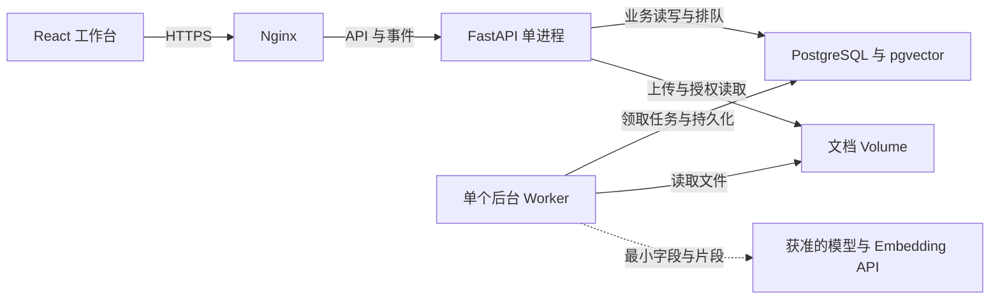

# 03 · 系统架构与部署

状态：拟采用架构，尚未实现或在腾讯云压测。面向单个企业的小范围试点，组织/项目字段仍需保留。

## 1. 技术决策

| 层 | 拟选型 | 职责及取舍 |
|---|---|---|
| 前端 | React + TypeScript | 输入问题、展示过程/证据、审阅任务；由 API 类型生成客户端，不承担鉴权或风险运算 |
| HTTP API | FastAPI + Pydantic | 身份、项目授权、数据校验、业务接口、事件读取；不直接阻塞等待长时间模型调用 |
| 应用层 | Python 模块化单体 | 导入、分析、知识、审批、任务各自模块；首版不拆微服务 |
| AI 编排 | LangGraph | 管理查询循环、状态、人工中断/恢复；领域规则不依赖框架 |
| 持久化 | PostgreSQL + pgvector | 业务表、任务队列、事件、检查点和小规模知识向量；不引入 Redis/独立向量库 |
| 后台执行 | 同一后端代码的单个 worker 进程 | 从数据库领取短任务，模型并发 1；与 API 进程分开，但不是独立微服务 |
| 模型接入 | Provider Adapter | 主选 DeepSeek；M1 词法 RAG，Embedding 后续独立配置；见 11，协议兼容性须实测，SDK 不泄漏进领域模块 |
| 文档文件 | 受控本地 volume + 元数据 | 通过鉴权接口下载；后期可换对象存储，业务仅引用 file_id |
| 入口/部署 | Nginx + Docker Compose | HTTPS、静态站点、反向代理；数据库仅内部网络可达 |

选择 LangGraph 是因为需要混合代码步骤与模型决策，并保存可恢复状态；它本身不提供本项目的业务权限和审批一致性。[官方概览](https://docs.langchain.com/oss/python/langgraph/overview)

## 2. 部署边界图

worker 的结果写入数据库；API 通过查询/事件读取并返回前端。LangGraph、规则模块与 RAG 都是 worker 内部模块，不画成需单独部署的服务。数据库队列是逻辑表，不是另一个消息系统。

## 3. 模块依赖与数据路径

依赖方向：HTTP 层 → application use cases → domain；数据库、文件、模型、检索和图编排通过明确的接口实现。domain 不导入 React、FastAPI、LangGraph 或具体模型 SDK。

数据导入先写暂存区，预检后一次发布 snapshot_set。分析固定一个快照集合，不能分别从库存最新表和订单最新表随意拼接。任何较新资料只产生“可重新分析”提示，不隐式修改历史结论。

运行请求先通过身份/项目授权，事务写 `agent_run + job + initial_event`，立即返回 202。worker 取任务，执行节点、落事件和证据；前端先用带游标轮询查看，若需要再加 SSE，不强制依赖长连接。

模型只能读受控工具返回的最小字段；最终建议需要结构化校验。批准请求创建审批记录和恢复任务；真正建业务待办由应用服务在事务中完成。检查点是执行状态，task/approval 是业务真相，二者不能混为一张表。

## 4. 队列、恢复与一致性

`jobs` 使用状态、lease_owner、lease_until、attempt、fencing_token。领取时使用短事务和行锁，执行模型时不持有数据库长事务。`SKIP LOCKED` 可用于这种队列领取；不用于正常业务查询以免悄悄跳过数据。[PostgreSQL SELECT](https://www.postgresql.org/docs/current/sql-select.html)

worker 心跳续租；进程退出后到期任务可再次领取。采用至少一次执行，旧 worker 的提交须校验租约代次，不能声称队列提供天然 exactly-once。模型重试可能增加费用，账单与请求日志需记录。

审批记录、草稿 revision、任务唯一键、审计及提交事件尽量放同一个数据库事务。若任务已提交而图检查点未保存，恢复时根据 approval_id 查到原 task_id 并补齐运行状态，不再次创建。

提交前锁定/比较项目当前快照指针、依据版本与权限；相关更新也使用一致的锁顺序/版本检查。批准与提交之间证据变化会转为 conflict，要求重新审阅，不能把旧审批挪给新草稿。

## 5. 鉴权和数据隔离

首版建议同源 Web + 服务端会话，HttpOnly/Secure Cookie、CSRF 防护、登录限流。M1 按用户要求开放本地演示注册，每个账号只获得自己的隔离演示项目；不可自助加入公司项目或获得全局管理员。真实公司成员使用邀请/审核，SSO 留适配口。具体见 13。

每个资源包含 org_id/project_id；查询、详情、证据下载、导出、向量检索、缓存及检查点访问都校验授权。模型请求中的项目 ID 不具备授权效力。

项目表可用 PostgreSQL RLS 作为第二层保护，使用非表拥有者且无 BYPASSRLS 的应用账号，并测试连接池事务内范围设置；不能以为开了 RLS 就覆盖表拥有者/超级用户的绕过行为。[官方 RLS 文档](https://www.postgresql.org/docs/current/ddl-rowsecurity.html)

框架检查点表至少按业务 run 映射隔离；不开放根据任意 thread_id 读取框架状态的接口。对日志、备份、模型服务也要划定访问范围。

## 6. 2 核 / 2GB / 50GB 的运行策略

初始部署为 Nginx、API 一个进程、worker 一个进程、数据库。API worker 数量与后台 worker 数量是两个概念；先单进程测内存，不能按 CPU 数直接成倍复制。[FastAPI workers](https://fastapi.tiangolo.com/deployment/server-workers/)

耐久的 Agent 任务不只依赖 FastAPI 请求后的 BackgroundTasks；采用上面的持久化队列与 worker，这是本项目的设计取舍。官方区分了简易后台任务与更复杂任务执行需求。[BackgroundTasks](https://fastapi.tiangolo.com/tutorial/background-tasks/)

建议测试起点：Agent 同时 1 个；导入/Embedding 串行且与分析互斥；API/worker 各小连接池；批量分页；小语料先精确向量检索；模型与向量模型不本地运行，扫描件 OCR 不在首版。

资源规划只作为预算：数据库约 350–500MB、API 150–250MB、worker 250–450MB、系统/代理/其他 350–450MB，还需预留余量。这不是测量值，也不是可直接照抄的硬限额。若实测不足，不以反复 OOM 或大量 swap 换“部署成功”，优先增内存/拆数据库。

前端和镜像在本地或 CI 构建；服务器不跑模型、编译和完整评测。磁盘需记录系统、镜像、数据库、文件、日志和检查点占用；日志轮转，拒绝无限上传/无限上下文。备份另存受控目的地，不能以同盘副本替代恢复保障。

## 7. 运维最低要求

`/health/live` 检查进程存活，`/health/ready` 检查数据库和关键依赖配置；不要每次探针调用付费模型。模型服务健康通过独立受限检查及实际错误率观察。

版本发布先数据库兼容迁移、再应用切换，失败能关闭 AI 或回退应用。文档索引/模型发布走版本指针，保留旧版本直到新版本验证完成。备份恢复必须在隔离环境试过才能宣称可恢复。

OS、地域、域名、公司访问方式、现有服务与可用内存还未核实；本稿没有替用户部署、开公网端口或发送公司数据。
