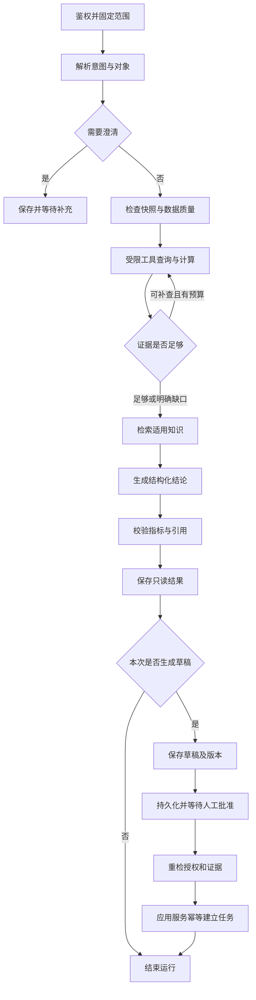

# 04 · Agent 设计

目标：一个具备有限工具选择能力、证据追踪和人工控制的运营 Agent。不是预设文本伪装模型，也不让模型自主操作生产库存。

## 1. Agent、规则和应用各自负责什么

| 能力 | 实现主体 | 为什么 |
|---|---|---|
| 理解问题、提取对象/时间/目标、识别歧义 | LLM + Schema 校验 + 人工澄清 | 处理自然语言与上下文 |
| 从许可查询中选择下一步、补查订单或批次 | LLM 的受限工具循环 | 依据当前问题与工具返回调整查询路径 |
| 权限、单位换算、消耗、日期、风险阈值与优先级 | 确定性代码 | 可复算、可测试，不能由语言生成决定 |
| 文档查询词改写、证据组织、行动草稿 | LLM + RAG | 把分散事实与适用制度组织成可读结果 |
| 引用 ID、数值、字段完整性和写入权限校验 | 代码；语义支持度另做评测 | LLM 不自证正确 |
| 行动批准与处置 | 授权人员 | AI 只能提出建议；应用服务执行已批准的精确内容 |

默认全项目巡检由规则先扫描完整范围并产出候选；LLM 只深入分析分页候选并披露覆盖范围。不能依赖模型自由翻页决定是否看完所有库存。

## 2. 运行模式与图结构

一个 Agent 支持 `analyze`、`follow_up`、`draft_action` 三种模式。前两种产出只读结果即可结束；用户在结果上点击生成草稿时建立关联的 `draft_action` 子运行，parent_run_id 指向分析，防止将已经完成的只读运行偷偷变成写操作。



错误路径：权限失败立即停止；数据不足进入数据核查结果；预算/模型失败进入 degraded 或 failed；人工拒绝结束该草稿运行；恢复冲突使草稿失效并要求新运行。暂停不占据 worker 或持续调用模型。

LangGraph 的 interrupt 恢复可能从节点开头重新执行，因此批准前不能放不可重复的业务写操作。生产检查点需持久化；业务提交仍须自己的幂等保护。[中断与恢复](https://docs.langchain.com/oss/python/langgraph/interrupts)

## 3. 状态与上下文设计

`AgentState` 保存引用和结构化摘要，不把全部原始文件塞进每个检查点：

| 分组 | 必要字段 |
|---|---|
| 身份/范围 | run_id、session_id、org_id、project_id、actor_id、mode、parent_run_id |
| 意图 | original_question、normalized_intent、entity_ids、window、clarification |
| 数据/版本 | snapshot_set_id、as_of、ruleset_version、knowledge_release_id |
| 工具/证据 | tool_result_ids、metric_ids、evidence_ids、data_issues、coverage |
| 模型 | provider、model_id、prompt_version、graph_version、usage、step_budget |
| 草稿/批准 | draft_id、draft_revision、approval_id、expected_evidence_hash |
| 运行 | status、node、attempt、error_code、cancel_requested、trace_id |

会话保存最近必要的用户问题、已确认对象和结果引用；长历史按限额摘要。关键数字、证据、权限和批准状态始终从服务器结构化记录读取，不能靠摘要记忆。首版不建设无限长期“自学习记忆”。

每个 run 使用服务器生成的 checkpoint thread_id。每次恢复重查 run 所属项目与当前身份。UI 展示节点摘要、工具名和依据，不展示或要求模型输出隐藏的逐步思维链。

## 4. 工具目录与权限

工具参数由 Schema 限定枚举、数量上限和时间窗；org/project/授权凭据由服务器注入，模型不得覆盖。所有返回包含 source_version、as_of、evidence_id、complete 和 warnings。

| 工具 | 模型可提供的参数 | 返回 | 写入性质 |
|---|---|---|---|
| resolve_items | name_or_code、department_hint | 许可项目内的候选编码/名称 | 只读；多候选需澄清 |
| get_inventory | item_ids、department_ids | 批次汇总、可用/冻结/预留与时间 | 只读 |
| get_consumption | item_ids、window_days（首版固定 14） | 日记录、缺失日、已校验日均 | 只读 |
| get_open_orders | item_ids | 确认状态、余量、预期日期 | 只读 |
| get_batches | item_ids | 批次、效期和库存状态 | 只读 |
| compute_risks | item_ids、规则许可的场景枚举 | 指标、风险、依据、缺口、适用范围 | 确定性函数；模型不能传入自造库存数 |
| search_knowledge | query、document_types | 已过滤权限/时间的片段和引用 | 只读；不能传任意 URL 抓取 |
| propose_task | analysis_id、建议标题/步骤 | Schema 合法的 draft candidate | 仅建议；持久化由应用完成，不建立业务任务 |

`commit_approved_task`、修改库存、成员权限、任意 SQL、shell、浏览器和外部消息工具不暴露给 LLM。批准后的图节点调用应用服务，参数只能来自已批准的草稿 revision。

工具错误采用 `NOT_FOUND / DATA_INCOMPLETE / STALE_DATA / FORBIDDEN / TIMEOUT / RATE_LIMITED / INVALID_ARGUMENT`，模型只能在白名单策略内补查或解释，不自创绕过方法。

## 5. 输出契约与证据验证

分析结果基本形状：

```json
{
  "schema_version": "1",
  "run_id": "run_demo_01",
  "answer_status": "supported",
  "generation_mode": "model",
  "summary": "存在需要核实的供应缺口",
  "finding_ids": ["finding_demo_01"],
  "metric_refs": ["metric_coverage_6d", "metric_lead_8d"],
  "claims": [
    {"text": "当前快照未查到未到货订单", "evidence_ids": ["ev_orders_01"]},
    {"text": "演示补货规则要求先核对库存并核实交期", "evidence_ids": ["ev_sop_01"]}
  ],
  "citations": [
    {"evidence_id": "ev_orders_01", "supports_claim": 0},
    {"evidence_id": "ev_sop_01", "supports_claim": 1}
  ],
  "unknowns": ["是否存在尚未同步的订单"],
  "suggested_actions": ["核对账实库存", "向商务人员核实未同步订单"],
  "coverage": {"requested_items": 1, "analyzed_items": 1, "skipped_items": 0}
}
```

这是形状示例，引用内容必须实际对应：订单查询支持“快照未查到订单”，制度片段支持核查要求。正式 validator 检查关联对象与来源，语义支持度还需评测；不能仅因 ID 存在就验收通过。

渲染数字从 metric_refs 读取服务器指标；模型文本中出现的关键数字也要与同范围工具值匹配。无法匹配则退回修正一次；仍失败显示规则结果并记录验证失败。权限不对的引用直接拦截，不能通过改写句子“修复”。

事实与推断分字段；`answer_status` 取 supported / insufficient / conflicting。严重性由规则决定，LLM 不任意升级；后续可以研究排序，但必须独立评测。

## 6. 执行预算与失败策略

待测初值：每次运行最多 4 次模型请求（包括一次修正）、12 次只读工具调用、2 轮澄清；LLM 总请求耗时上限 90 秒，单次超时 30 秒；上下文输入预算约 8,000 tokens，输出最多 1,500 tokens。供应商能力和长中文材料实测后调整，版本化记录。

429/临时网络错误最多重试 2 次且受总预算限制；重试计入调用次数和成本。模型调用不做业务事务重试的一部分，避免数据库失败触发无上限生成。

无模型密钥/服务不可用时可运行规则分析，结果标记 `generation_mode=rules_only`、run=degraded；不使用固定文案假装 AI 成功。检索无结果不自动全网补证。模型响应迟到、运行取消或租约过期时，拒绝保存可执行草稿。

初版成本统计包含模型、Embedding、重试与可选评估调用；本稿不设没有单价依据的人民币承诺。接入模型时配置运行上限、每日预算和停止行为。

## 7. 验证 AI 的实际贡献

同一套案例比较：A 规则 + 模板；B 规则 + 固定 RAG 回答；C 规则 + RAG + 有限工具选择 Agent。比较正确率、遗漏、证据支持、任务可用性、耗时与成本。如果 C 对某类固定巡检无增益，就保留 A/B 路径；Agent 的价值应体现在复杂问题和补查能力，不是调用次数多。

模型主选按用户最新指令改为 DeepSeek `deepseek-flash`（可配置），见 11/13。无 key 时先做显式 mock 的工程验收，真实模型验收单列。使用相同工具 Schema 和案例对照一个可用候选，记录真实模型 ID、结构化输出/工具调用兼容性、区域和数据使用条件；只有验证失败或实际收益支持时才变更主选。未测试前不能写“已支持所有 OpenAI-compatible 模型”。

## 8. 提示词与版本边界

分离并版本化：意图解析、工具选择、证据回答、草稿生成、格式修正。每份提示词包含任务边界、许可工具、Schema、证据不足行为和少量独立开发集示例。评测集不能复制进提示词来抬高分数。

文档和工具内容视为输入数据，不接受其“忽略规则/调用某地址”等指令。权限与调用限额在代码强制执行；提示词里的禁止语句只是辅助手段。
