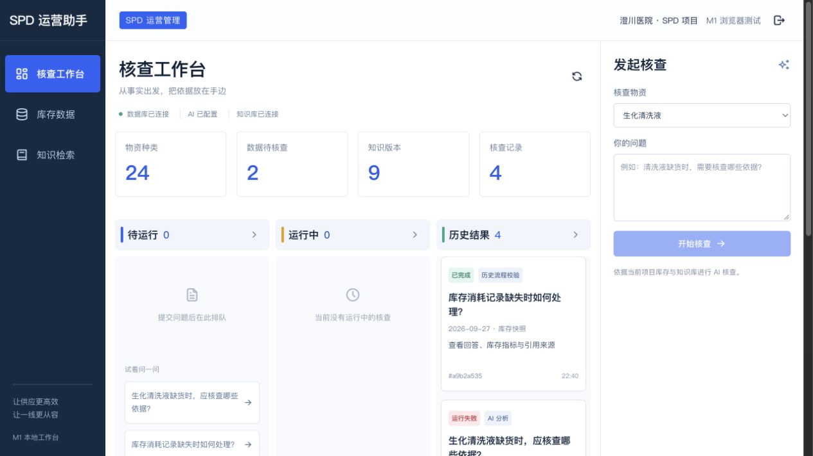
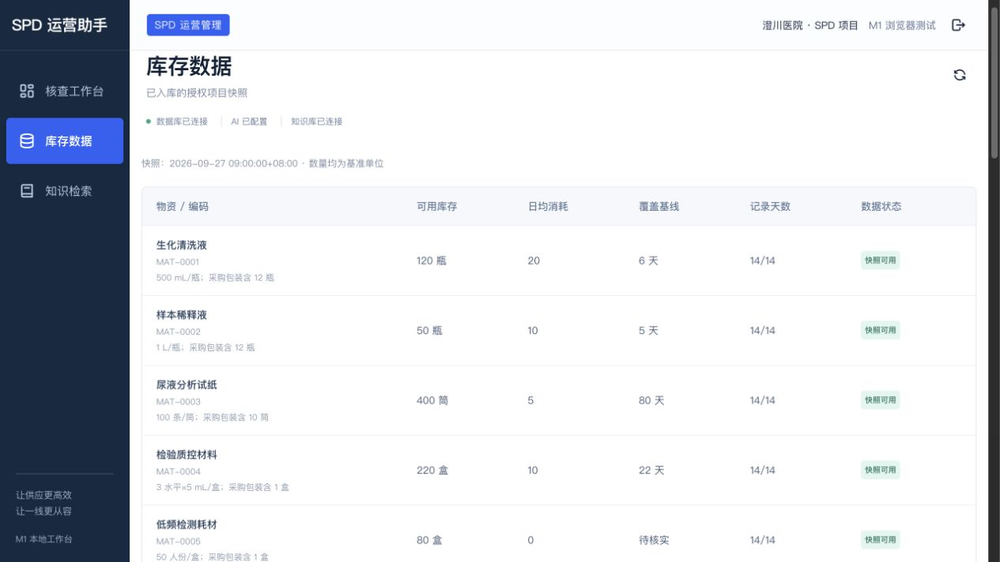

# 后台 UI 审查与组件库建议

日期：2026-09-27。范围：核查工作台 → 库存查询；当前 Codex 主代理通过内置浏览器实际操作并保存截图，非独立人工 QA。此轮为建议，不替换现有业务界面。

## 1. 工作台：主任务被布局挤压

优点：三个业务导航明确，运行状态有文字标签，项目归属清楚。

问题：常态下“待运行”和“运行中”为空，却占据主要宽度；历史结果被挤在窄列，主操作又放在右侧窄栏。用户需要同时理解统计卡、三列队列和核查表单，主次不清。辅助文字偏小且浅，对低视力用户有可读性风险（未测量对比度，不作为 WCAG 不合格结论）。

建议：改成主内容列表 + 明确的“新建核查”操作，运行状态用标签页/筛选；新建表单及结果详情按需用抽屉展开。将异常库存和待处理项置于首页，执行队列作为二级信息。

## 2. 库存查询：数据可读，查找效率不足

优点：数量、基础单位、业务时间、数据质量状态清楚保留，表头具备语义。

问题：当前 24 行物资没有搜索框、筛选、排序、分页或物资详情操作，用户只能纵向滚动；每行名称/编码/规格都占三行，密度不适合后台扫表。库存页无法直接对某行发起 AI 核查，必须切回工作台再选物资。辅助编码、规格和状态字较小较浅，存在可读性风险。

建议：搜索物资名称/编码，按科室、数据质量筛选，支持覆盖天数排序和分页；规格放到详情抽屉或可展开行；行内提供“查看依据”“发起核查”。这些是业务交互改造，不能靠换主题自动得到。

## 选型

当前源码只使用 React/TypeScript + 自定义 CSS + Tabler 图标，没有完整 UI 组件库。

优先建议 Ant Design，按需接入 Table、Form、Select、Drawer、Tabs、Descriptions、Alert、Skeleton，统一字体、间距、颜色、边框及紧凑密度。当前 React/Vite 和后端接口保留，不迁移整个脚手架。复杂表格后续按实际需要引入 ProComponents，不必一开始全量安装。

- Ant Design Table 内置筛选、排序、分页和固定表头，符合现有库存/运行列表任务：https://ant.design/components/table/
- 可通过主题配置统一样式，不必照搬默认视觉：https://ant.design/docs/react/customize-theme/
- shadcn/ui 更适合强调自定义视觉的方案，但 Data Table 要自行组合 TanStack Table 和交互，当前后台交付需更多整合工作：https://ui.shadcn.com/docs/components/base/data-table

建议视觉方向：浅色导航、灰白底、深色正文、克制的蓝色操作、紧凑表格；保留单一主动作，降低空状态和运行队列的视觉权重。

边界：本次是两屏桌面流程审查，未完成键盘全流程、读屏、对比度数值和移动端验收；不宣称 WCAG 合规。所有截图在本轮实际捕获并检查，未使用历史截图代替。未修改业务页面或安装第三方 UI 库。

## DeepSeek 实际接入验证（独立于 UI 审查）

用户已在 backend/.env 填入密钥，本轮仅检查其存在性，不输出密钥。官方 api.deepseek.com 的 GET /models 返回 HTTP 200，账号返回 deepseek-flash、deepseek-v4-pro。随后重启当前本地 API、worker 和 Vite，页面显示“AI 已配置”。

通过既有浏览器测试账号提交一次实际核查：查询生化清洗液库存、14 日消耗、覆盖天数并检索补货制度。

- run_id：d6206df8-4b20-400d-986a-66c335f141bc
- provider：deepseek；请求和响应模型均为 deepseek-flash
- 实际响应 usage：prompt 649、completion 100、total 749 tokens；费用金额未知，未据此推算账单
- 最终运行：failed，TOOL_SCOPE_REJECTED，约 1.29 秒，无 Analysis
- 模型提出 get_inventory(item_ids=["生化清洗液"])；本次授权 item_ids=["SIM-P001"]，参数名称被当成 ID，服务端拒绝越界；另提出 search_knowledge，但未完成工具节点提交
- 代码证据：execute 初始 messages 仅包含 SYSTEM 和问题，没有传递服务端选中物资的名称/ID 对照；InventoryArgs 的 ID 字段也没有参数语义描述。需要补充可信上下文和 Schema 说明，并验证普通自然语言问题；不能通过放松权限或让用户输入内部 ID 来规避

结论：密钥认证与真实模型请求通过；Agent 端到端失败，尚未得到工具检索和带引用最终回答。这是实际联调发现的问题，不标为接入全部完成。本轮只诊断，未修改 Agent 实现。
